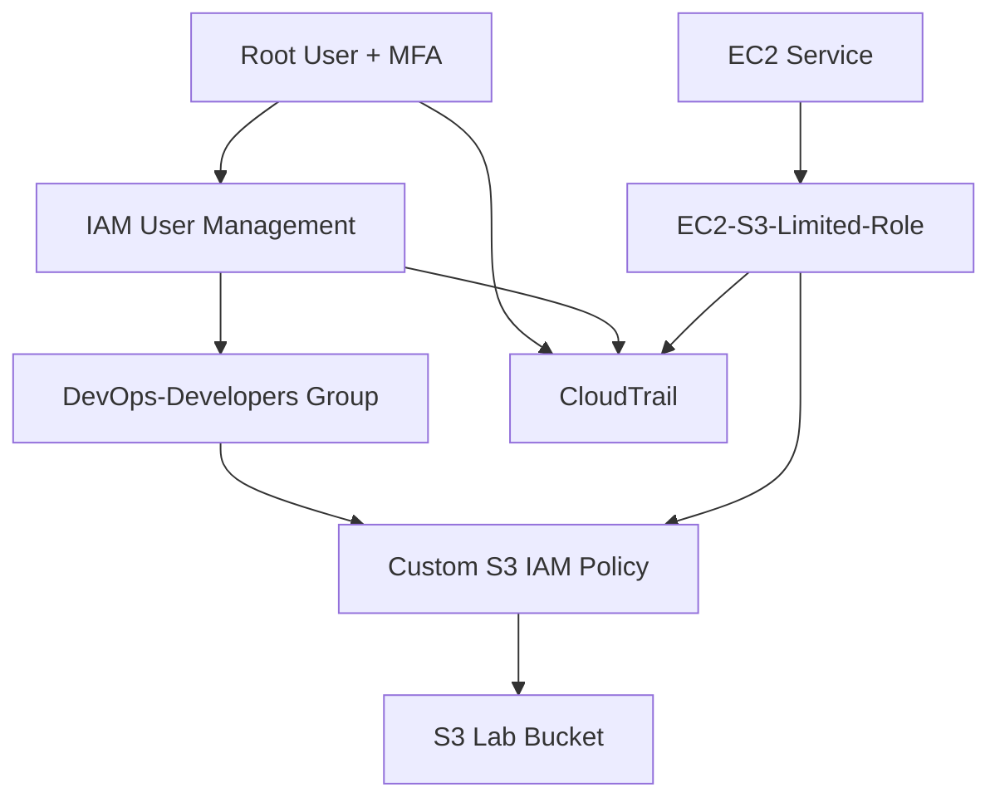

# aws-secure-iam-architecture# AWS Secure IAM Architecture – Least Privilege Access Control

## 1. Project Overview

This project demonstrates how to build a secure AWS IAM architecture using users, groups, custom IAM policies, IAM roles, and CloudTrail auditing.

The main objective is to implement the **Principle of Least Privilege**, ensuring that every identity receives only the permissions required to perform its tasks.

## 2. Architecture



## 3. AWS Services Used

- AWS IAM
- Amazon S3
- AWS EC2 IAM Roles
- AWS STS
- AWS CloudTrail

## 4. Implementation Steps

### Step 1: Root Account Security
- Enabled Multi-Factor Authentication (MFA).
- Verified that no root access keys were present.
- Avoided using root for regular development tasks.

### Step 2: IAM Group
Created the IAM group:

`DevOps-Developers`

### Step 3: IAM User
Created the IAM user:

`devops-user`

Added the user to the `DevOps-Developers` group.

### Step 4: Custom IAM Policy

Created the managed policy:

`DevOps-S3-Limited-Access`

Policy permissions:
- `s3:ListAllMyBuckets`
- `s3:ListBucket`
- `s3:GetObject`
- `s3:PutObject`

The policy grants object read/write access only to the designated lab bucket.

### Step 5: Policy Attachment

Attached the custom policy to the `DevOps-Developers` group instead of assigning permissions directly to the user.

### Step 6: S3 Permission Testing

Tested permissions using the IAM developer user.

| Operation | Expected/Observed |
|---|---|
| List bucket names | Allowed after policy update |
| List lab bucket contents | Allowed |
| Upload object | Successful |
| Download object | Successful |
| Delete object | Denied |
| List IAM policies | Denied |

### Step 7: EC2 IAM Role

Created:

`EC2-S3-Limited-Role`

Trusted entity:

`ec2.amazonaws.com`

Attached the limited S3 access policy.

The trust relationship uses:

`sts:AssumeRole`

**Note:** The role was created and its permissions and trust relationship were reviewed. It has not yet been tested on a running EC2 instance.

### Step 8: CloudTrail Auditing

Used CloudTrail Event History to verify IAM management activity.

Verified event names:
- `CreateRole`
- `CreatePolicy`
- `AttachGroupPolicy`
- `AttachRolePolicy`

CloudTrail Event History provides visibility into recent management events.

## 5. Custom IAM Policy JSON

```json
{
  "Version": "2012-10-17",
  "Statement": [
    {
      "Sid": "AllowListingBucketNames",
      "Effect": "Allow",
      "Action": "s3:ListAllMyBuckets",
      "Resource": "*"
    },
    {
      "Sid": "AllowBucketListing",
      "Effect": "Allow",
      "Action": "s3:ListBucket",
      "Resource": "arn:aws:s3:::devops-iam-lab-2026-unique"
    },
    {
      "Sid": "AllowObjectReadWrite",
      "Effect": "Allow",
      "Action": [
        "s3:GetObject",
        "s3:PutObject"
      ],
      "Resource": "arn:aws:s3:::devops-iam-lab-2026-unique/*"
    }
  ]
}
```

## 6. Key Security Concepts Learned

- Principle of Least Privilege
- IAM Users and Groups
- Managed IAM Policies
- Identity-based permissions
- IAM Role and Trust Policy
- EC2 Service Role
- AWS STS
- Explicit Deny and implicit Deny
- CloudTrail auditing
- Root account security with MFA

## 7. Project Results

Successfully implemented and tested a restricted developer access model.

The developer can list and access the designated S3 bucket, upload and download objects, but cannot delete objects or list IAM policies.

The EC2 role configuration was created for a future instance-based test.

## 8. Future Improvements

- Attach the IAM role to an EC2 instance and test temporary credentials.
- Verify role access using AWS CLI and `aws sts get-caller-identity`.
- Implement cross-account IAM role access.
- Configure IAM Access Analyzer.
- Add automated security checks.

## 9. Security Notes

- Never upload AWS credentials, passwords, access keys, MFA QR codes, or account-specific identifiers.
- Keep S3 Block Public Access enabled.
- Do not commit `.env` files or secrets.
- Review AWS resource usage and clean up unused resources.

## 10. Author

Cloud & DevOps Learning Project

**Technologies:** AWS IAM | S3 | EC2 | STS | CloudTrail

**Project Level:** Beginner to Intermediate AWS Security Practical
